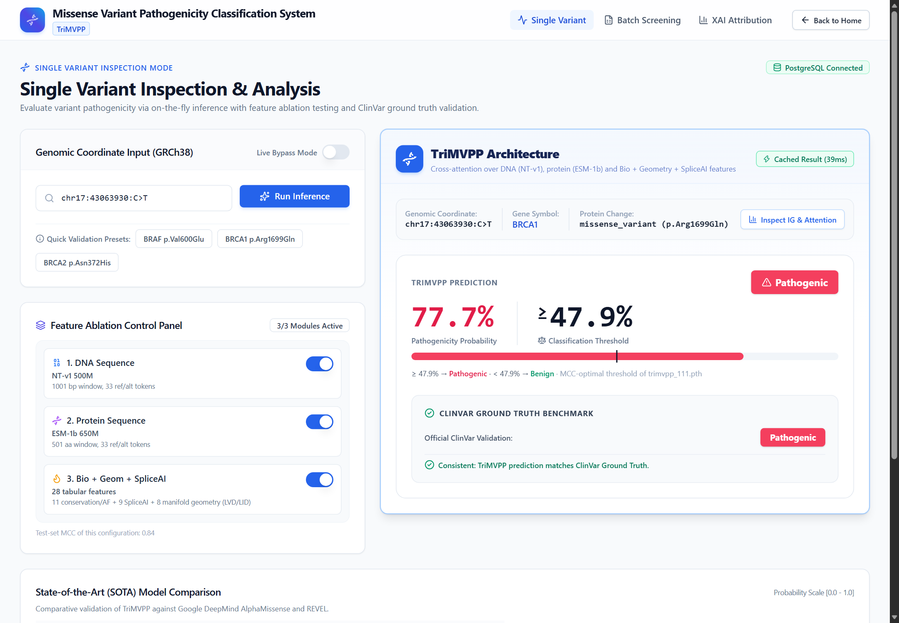
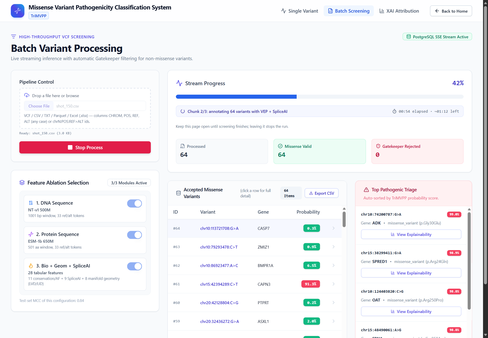
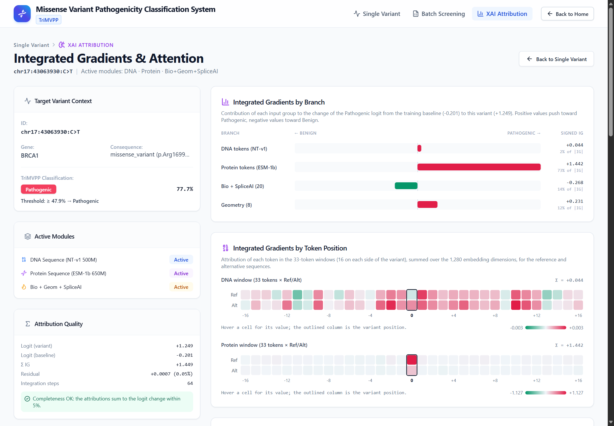
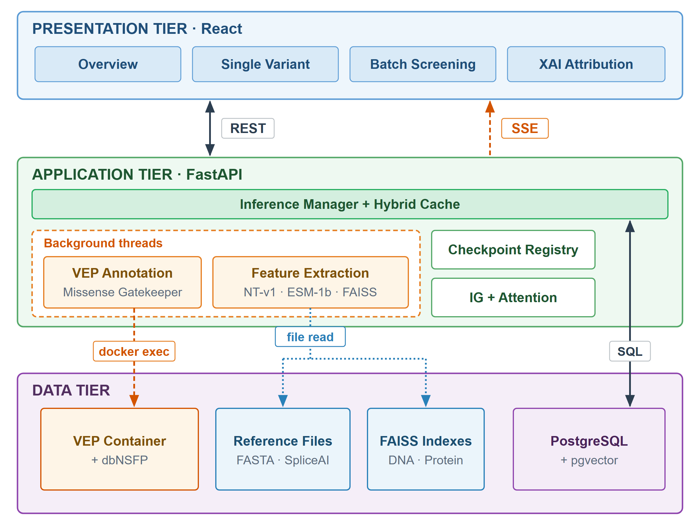

# TriMVPP Web Demo

Web application for **TriMVPP** (Tri-Modal Variant Pathogenicity Predictor), the missense variant pathogenicity model
of this project. Given a variant in GRCh38 coordinates, it annotates the variant, extracts DNA, protein and tabular
features, predicts the probability that the variant is pathogenic, and explains the prediction. Files of thousands
of variants can be screened with results streamed to the browser while they are computed.

| Single variant | Batch screening | Explainability |
|---|---|---|
|  |  |  |

## Contents

- [Features](#features)
- [Architecture](#architecture)
- [Directory structure](#directory-structure)
- [Requirements](#requirements)
- [Setup](#setup)
- [Running the application](#running-the-application)
- [Usage](#usage)
- [API](#api)
- [Performance](#performance)
- [Troubleshooting](#troubleshooting)

## Features

- **Single-variant prediction.** Enter a variant such as `chr7:140753336:A>T` and get the pathogenicity probability,
  the decision threshold of the active model, the predicted label, the ClinVar label, and a comparison with
  AlphaMissense and REVEL.
- **Missense gatekeeper.** Variants are annotated with Ensembl VEP; only missense variants are classified. Other
  variants, and invalid coordinates, are rejected with the reason.
- **Selectable input modules.** Enable or disable the DNA (Nucleotide Transformer v1 500M), protein (ESM-1b 650M) and
  Bio + Geometry + SpliceAI modules. Each of the seven combinations uses its own trained checkpoint and threshold.
- **Explainability.** Integrated Gradients per input group, per sequence token and per tabular feature, and the
  cross-attention maps between the branches. Attributions are computed the first time the view is opened and stored.
- **Batch screening.** Upload a VCF, CSV, TXT, Parquet or Excel file (or drop it onto the page). Variants are
  processed in chunks of 64; each result is streamed as soon as it is ready, with the progress per chunk and an
  estimate of the remaining time. A run can be stopped at any time, and all results, including rejected variants
  with their reason, can be exported as CSV.
- **Caching.** Features and predictions are stored in PostgreSQL (pgvector): a repeated query is answered in
  milliseconds, and a change of the input modules does not repeat the feature extraction.

## Architecture



| Layer | Technology |
|---|---|
| Frontend | React 19, TypeScript, Vite, Tailwind CSS, Recharts |
| Backend | FastAPI, PyTorch, Hugging Face Transformers, Server-Sent Events for batch streaming |
| Database | PostgreSQL 16 with pgvector (Docker container `rbnet_postgres`) |
| Annotation | Ensembl VEP with the dbNSFP plugin (Docker container `rbnet_vep`), SpliceAI precomputed scores |

A detailed description of the processing pipeline, the database schema and the design decisions is given in
[docs/SYSTEM_ARCHITECTURE_OVERVIEW.md](docs/SYSTEM_ARCHITECTURE_OVERVIEW.md).

## Directory structure

```
web_demo/
├── backend/
│   ├── app/
│   │   ├── api/v1/endpoints/   # predict.py (single, batch), xai.py, health.py
│   │   ├── core/               # settings, constants, errors, logging
│   │   ├── db/, models/        # SQLAlchemy session and tables (variants, predictions, inference_features)
│   │   ├── ml_core/            # TriMVPP model, foundation models, geometry features, Integrated Gradients
│   │   ├── schemas/            # request and response models
│   │   └── services/           # VEP runner, feature pipeline, inference, checkpoint registry, upload parser
│   ├── artifacts/              # checkpoints, scalers, FAISS indexes, IG baseline (not in git, see Requirements)
│   ├── scripts/                # init_db.py, check_db.py, download_models.py
│   ├── requirements.txt
│   └── .env.example            # backend settings template
├── frontend/
│   └── src/
│       ├── pages/              # Home, Single, Batch, Xai
│       ├── components/         # ablation panel, XAI charts, UI primitives
│       └── services/api.ts     # REST and SSE client
├── docs/
│   ├── SYSTEM_ARCHITECTURE_OVERVIEW.md
│   └── figures/
├── docker-compose.yml          # PostgreSQL + pgvector
├── .env.example                # database credentials template for docker-compose.yml
├── start_system.bat            # starts database, VEP, backend and frontend (Windows)
└── stop_system.bat
```

## Requirements

**Hardware.** An NVIDIA GPU with at least 8 GB of memory is recommended (development used an RTX 4060 Laptop GPU).
The backend also runs on CPU, much more slowly. Plan for about 120 GB of free disk space: about 27 GB for the VEP
cache, about 80 GB for the reference resources (GRCh38 FASTA, dbNSFP, SpliceAI scores), and the foundation model
weights.

**Software.**

- Windows 10/11 (the start scripts are batch files; the application itself is cross-platform)
- Python 3.10
- Node.js 20 or later
- Docker Desktop

**Data and model files not stored in git.** The following files are too large for the repository.
**Contact a team member to obtain them**, then place them at the paths configured in `backend/.env`.

| Item | Location (default) |
|---|---|
| 7 TriMVPP checkpoints `trimvpp_{111,110,101,011,100,010,001}.pth` | `backend/artifacts/trimvpp/checkpoints/` |
| Geometry scalers `*_geom_v2_scalers.pkl` | `backend/artifacts/trimvpp/geom_scalers/` |
| FAISS indexes `*.index` (local intrinsic dimension) | `backend/artifacts/trimvpp/faiss_indexes/` |
| Biological feature scalers `bio_*.pkl` | `backend/artifacts/` |
| Integrated Gradients baseline `ig_baseline_train3_seed2026.pt` | `backend/artifacts/trimvpp/` |
| GRCh38 genome and Ensembl peptide FASTA | `HG38_FASTA_PATH`, `HG38_PEP_FASTA_PATH` |
| SpliceAI precomputed scores (`.vcf.gz` + index) | `SPLICEAI_VCF_PATH` |
| Ensembl VEP cache (release 116), dbNSFP 5.3.1a and the dbNSFP VEP plugin | mounted into the VEP container |

The foundation models (NT-v1 500M and ESM-1b 650M, about 5 GB) are downloaded from Hugging Face by a script (step 3
below).

## Setup

All commands are for PowerShell, run from the `web_demo` folder unless stated otherwise.

### 1. Database credentials

```powershell
Copy-Item .env.example .env
```

Open `.env` and choose a password for `POSTGRES_PASSWORD`. Docker Compose reads this file when the database
container is created; the password is never written in `docker-compose.yml`.

### 2. Backend settings

```powershell
Copy-Item backend\.env.example backend\.env
```

In `backend\.env`, set:

- `DATABASE_URL` with the same user, password, port and database as `.env`:
  `postgresql://rbnet_user:<POSTGRES_PASSWORD>@localhost:5433/rbnet_genomics`
- the paths of the reference files (`HG38_FASTA_PATH`, `HG38_PEP_FASTA_PATH`, `SPLICEAI_VCF_PATH`), of the VEP
  exchange folder (`VEP_TMP_DIR`), and of the Hugging Face cache (`HF_HOME`).

### 3. Python environment and foundation models

```powershell
cd backend
python -m venv .venv
.venv\Scripts\pip install torch==2.4.1 --index-url https://download.pytorch.org/whl/cu121
.venv\Scripts\pip install -r requirements.txt
.venv\Scripts\python scripts\download_models.py
cd ..
```

Use the CPU build of PyTorch instead if no NVIDIA GPU is available.

### 4. Database container

```powershell
docker compose up -d db
cd backend
.venv\Scripts\python scripts\init_db.py
.venv\Scripts\python scripts\check_db.py
cd ..
```

`init_db.py` enables pgvector and creates the tables; `check_db.py` verifies the connection and the schema.

### 5. VEP container

The VEP container is created once and then started by `start_system.bat`. Adapt the three host folders to your
machine: the VEP cache (with the `Plugins` folder), the reference resources (GRCh38 FASTA and dbNSFP), and the
exchange folder set as `VEP_TMP_DIR` in `backend\.env`.

```powershell
docker run -d --name rbnet_vep --restart unless-stopped `
  -v F:/VEP_CACHE:/vep_cache `
  -v F:/VEP_RESOURCES:/vep_resources `
  -v F:/BioData/vep_data/tmp_io:/tmp_io `
  ensemblorg/ensembl-vep:latest tail -f /dev/null
```

### 6. Frontend

```powershell
cd frontend
npm install
cd ..
```

## Running the application

**With the start script (Windows).** Open Docker Desktop, then double-click `start_system.bat`. It starts the
`rbnet_postgres` and `rbnet_vep` containers, opens the backend and the frontend in two windows, and opens
<http://localhost:5173>. The containers are addressed by name, so the script works from any folder. Use
`stop_system.bat` to stop the containers, and close the two windows.

**Manually.**

```powershell
docker start rbnet_postgres rbnet_vep

# terminal 1
cd backend
$env:PYTHONUTF8 = "1"
.venv\Scripts\python -m uvicorn app.main:app --port 8000

# terminal 2
cd frontend
npm run dev
```

| Service | Address |
|---|---|
| Web application | <http://localhost:5173> |
| API documentation (Swagger) | <http://localhost:8000/docs> |
| Health check | <http://localhost:8000/api/v1/health> |
| PostgreSQL | `localhost:5433` |

The backend loads the foundation models when it starts (15 to 30 seconds). Do not use `--reload`: each reload loads
the models onto the GPU again.

## Usage

**Variant notation.** GRCh38 coordinates as `chr7:140753336:A>T`. The `chr` prefix is optional, letters may be
lower case, and `:`, `-`, `_`, `/` or spaces are accepted as separators (`7-140753336-A-T`,
`chr7 140753336 A T`). Only single-nucleotide substitutions that VEP annotates as missense are classified.

**Batch files.**

| Format | Expected content |
|---|---|
| `.vcf` | Standard VCF rows (`CHROM POS ID REF ALT ...`) |
| `.csv`, `.parquet`, `.xlsx` | Columns `CHROM`, `POS`, `REF`, `ALT` (any case), or one column of `chrN:POS:REF>ALT` identifiers |
| `.txt` | One `chrN:POS:REF>ALT` identifier per line, or VCF-like rows |

Duplicated variants are processed once. Without a file, *Start Screening* runs a built-in demo cohort of 10
variants. Keep the page open while a screening runs; leaving it asks for confirmation and stops the run.

**Input modules.** The seven configurations, their MCC-optimal decision thresholds and their MCC on the test set:

| DNA | Protein | Bio + Geom + SpliceAI | Checkpoint | Threshold | Test MCC |
|:-:|:-:|:-:|---|---|---|
| ✓ | ✓ | ✓ | `trimvpp_111.pth` | 0.479 | 0.84 |
| ✓ | ✓ |   | `trimvpp_110.pth` | 0.634 | 0.73 |
| ✓ |   | ✓ | `trimvpp_101.pth` | 0.752 | 0.77 |
|   | ✓ | ✓ | `trimvpp_011.pth` | 0.566 | 0.84 |
| ✓ |   |   | `trimvpp_100.pth` | 0.482 | 0.26 |
|   | ✓ |   | `trimvpp_010.pth` | 0.738 | 0.59 |
|   |   | ✓ | `trimvpp_001.pth` | 0.631 | 0.76 |

Probabilities of different configurations come from different models and should be compared with their own
threshold, not with each other.

## API

Base path: `/api/v1`. The full schema is available at `/docs`.

| Method | Endpoint | Description |
|---|---|---|
| `POST` | `/predict/single` | Predict one variant. Body: `variant_id`, `use_dna`, `use_prot`, `use_biogeom`, `use_cache` |
| `POST` | `/predict/batch-upload` | Upload a file (multipart) and receive the results as a Server-Sent Events stream |
| `GET` | `/predict/batch-stream` | Screen the built-in demo cohort as a Server-Sent Events stream |
| `GET` | `/xai/{variant_id}?ablation_mask=15` | Integrated Gradients and attention maps of a prediction |
| `GET` | `/health` | Status of the database, checkpoints, artifacts and foundation models |

The batch stream sends five event types: `stream_status` (stage of each chunk), `variant_stream` (a classified
variant), `variant_skipped` (a rejected variant with its reason), `stream_completed` and `stream_error`.

```powershell
curl.exe -X POST http://localhost:8000/api/v1/predict/single `
  -H "Content-Type: application/json" `
  -d '{\"variant_id\": \"chr7:140753336:A>T\"}'
```

## Performance

Measured on an AMD Ryzen 7 8745H, 32 GB RAM and an RTX 4060 Laptop GPU (8 GB), foundation models in FP16.

| Scenario | Time |
|---|---|
| New variant (VEP annotation, feature extraction, prediction) | about 3.5 s, of which VEP about 2.9 s |
| Repeated query (stored prediction) | about 20 ms |
| Change of the input modules (stored features) | 30 to 75 ms |
| Explainability view, first opening / later openings | about 0.5 s / 0.15 s on the server |
| Batch of 150 new variants | first results after about 30 s, complete after 70 to 85 s |
| Batch of 6000 new variants | complete after about 53 min (0.53 s per variant) |

The predictions of the web application match those of the research checkpoints: on 100 held-out test variants,
the probabilities differ by less than 0.01 in all seven configurations and the labels agree.

## Troubleshooting

| Symptom | Cause and solution |
|---|---|
| *PostgreSQL is not reachable* | Docker Desktop or the `rbnet_postgres` container is not running. Start Docker Desktop and run `start_system.bat` (or `docker start rbnet_postgres`). |
| *VEP container 'rbnet_vep' failed* | The VEP container is not running or has not been created. Run `docker start rbnet_vep`, or create it (Setup, step 5). Variants already stored can still be queried. |
| `docker compose up` reports that the name `rbnet_postgres` is already in use | The container already exists (created from another folder). Start it with `docker start rbnet_postgres`; do not create a second one. |
| `docker compose` asks for `POSTGRES_PASSWORD` | `.env` is missing next to `docker-compose.yml` (Setup, step 1). |
| A configuration is reported as missing in `/health` | Its checkpoint is not in `backend/artifacts/trimvpp/checkpoints/`. |
| The first prediction after start-up is slower | One-time GPU warm-up; later predictions run at normal speed. |
| CUDA out of memory | Close other GPU applications; the two foundation models need about 2.3 GB in FP16. Set `INFERENCE_DEVICE=cpu` in `backend\.env` to run without GPU. |
